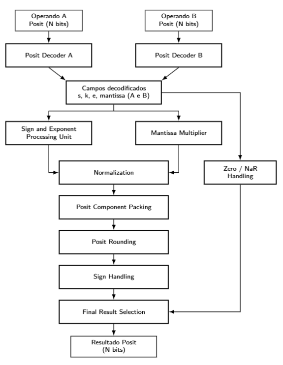

# Generic Posit (N, ES) Multiplier — VHDL

A **parameterized, combinational Posit multiplier** developed in VHDL-2008. The design includes Posit decoding, sign/scale processing, significand multiplication, normalization, packing and **round-to-nearest, ties-to-even (RNE)**.

**Author:** Matheus Viganó Schirrmann  
**Research group:** ProtoFPGA — Universidade Federal de Santa Catarina (UFSC)  
**Target FPGA:** Digilent Nexys A7-100T, Artix-7 (xc7a100tcsg324-1)  
**Synthesis and implementation tool:** Vivado 2026.1

The implementation is parameterized by total bit width **N** and exponent size **ES**, including ES = 0. Functional verification and Artix-7 synthesis/implementation results are available for the five configurations documented below.

## Documentation

[**English technical documentation**](documentation/README.md) — dedicated folders for numerical representation, conversion methods, and future VHDL module notes.

## Understanding Posit arithmetic

A finite, nonzero Posit contains four logical fields:

~~~text
| sign | regime (variable length) | exponent (up to ES bits) | fraction |
~~~

The represented number is

$$
x=(-1)^s\,\mathrm{useed}^{k}\,2^e(1+f),
\qquad \mathrm{useed}=2^{2^{ES}}.
$$

Equivalently,

$$
\boxed{x=(-1)^s\,2^{k\,2^{ES}+e}(1+f)}
$$

Here **s** is the sign bit, **k** the regime value, **e** the exponent, and **f** the fractional part of the significand. The implicit leading bit gives the significand **1 + f**.

The regime is formed by a run of identical bits followed, when space permits, by the opposite bit:

$$
k=\begin{cases}
m-1, & \text{run of }m\text{ ones},\\
-m,  & \text{run of }m\text{ zeros}.
\end{cases}
$$

Because the regime length varies, fewer bits may remain for exponent and fraction. This gives Posit its **tapered precision**. For negative encodings, the decoder first obtains the magnitude through two's complement.

There are two reserved encodings: zero (all zero bits) and **NaR** (sign bit one, remaining bits zero). In this multiplier, NaR takes precedence over zero.

### Posit multiplication

For two finite nonzero values:

$$
A=(-1)^{s_A}2^{k_A2^{ES}+e_A}(1+f_A)
$$

$$
B=(-1)^{s_B}2^{k_B2^{ES}+e_B}(1+f_B)
$$

the unrounded product is

$$
\boxed{AB=(-1)^{s_A\oplus s_B}
2^{(k_A+k_B)2^{ES}+e_A+e_B}
(1+f_A)(1+f_B)}
$$

**Sign processing:**

$$s_{\mathrm{prod}}=s_A\oplus s_B$$

**Exponent addition and carry propagation (ES > 0):**

$$
e_{\mathrm{sum}}=e_A+e_B,\qquad
k_{\mathrm{tmp}}=k_A+k_B+
\left\lfloor\frac{e_{\mathrm{sum}}}{2^{ES}}\right\rfloor
$$

$$e_{\mathrm{tmp}}=e_{\mathrm{sum}}\bmod 2^{ES}$$

For ES = 0, no exponent bits are stored and the regime values are added directly.

**Mantissa multiplication:**

$$M=(1+f_A)(1+f_B),\qquad 1\le M<4$$

If the product has **M >= 2**, the normalization stage divides the significand by two and adds one to the combined scale, carrying into the regime if needed.

The packing stage assembles the variable-length regime, exponent and fraction and supplies guard/sticky bits for rounding. For the ordinary RNE case, with **L** the retained least-significant bit, **G** the guard bit and **S** the sticky bit:

$$\mathrm{roundUp}=G\land(S\lor L)$$

Extreme regime boundaries require additional rounding handling in the packing module. The final sign is applied to the rounded magnitude.

## Hardware architecture

The diagram below is the **Posit multiplier architecture image provided for this project**, depicting the component extraction, parallel scale/mantissa paths, normalization, packing and rounding.

The synthesizable code is organized as follows:

| VHDL module | Responsibility |
|---|---|
| [decoder_posit_generic.vhd](rtl/decoder_posit_generic.vhd) | Decode sign, regime, exponent, fraction, zero and NaR |
| [sign_and_exponent_PU_generic.vhd](rtl/sign_and_exponent_PU_generic.vhd) | XOR signs, add exponents and propagate carries |
| [mantissa_multiplier_generic.vhd](rtl/mantissa_multiplier_generic.vhd) | Multiply significands |
| [normalization_generic.vhd](rtl/normalization_generic.vhd) | Normalize the product and adjust its scale |
| [posit_component_packing_generic.vhd](rtl/posit_component_packing_generic.vhd) | Assemble Posit fields and generate guard/sticky |
| [posit_rounding_generic.vhd](rtl/posit_rounding_generic.vhd) | Apply RNE rounding and sign |
| [posit_multiplier_top_generic.vhd](rtl/posit_multiplier_top_generic.vhd) | Integrate the datapath and handle NaR/zero |

**Top-level entity:** posit_multiplier_top_generic. Generics: N (default 8), ES (default 1). Inputs: positA and positB. Output: positResult, each N bits wide. The design has no clock or internal pipeline registers.

## Repository layout

~~~text
rtl/                       7 synthesizable generic VHDL modules
verification/
  tb/                      7 unit testbenches + 1 reference testbench
  test_vectors/            4 exact-reference operand/result vector sets
  generate_vectors.py      independent Python reference generator
docs/images/               image slots (to be uploaded)
README.md
.gitignore
~~~

## Functional verification

The complete multiplier was compared against independently generated Posit results using **exact rational arithmetic**. Simulation was carried out using **Vivado XSim 2026.1**.

| Format | Number of pairs | Verification | Result |
|---|---:|---|---|
| Posit(8,0) | 65,536 | All possible operand pairs | PASS |
| Posit(8,1) | 65,536 | All possible operand pairs | PASS |
| Posit(16,2) | 20,000 | Directed/random sampling | PASS |
| Posit(32,2) | 20,000 | Directed/random sampling | PASS |
| Posit(64,2) | 20,000 | Directed/random sampling | PASS |
| **Total** | **191,072** | | **PASS** |

These results validate the tested configurations, **not arbitrary widths**. The 8-bit configurations were tested exhaustively; 16-, 32- and 64-bit configurations used directed/random samples.

### Vivado simulation waveform — Posit(8,1)

Behavioral simulation of the combinational top-level, using five example operations. The waveforms show **Posit bit-pattern encodings in hexadecimal**, not ordinary decimal values: `0x40 × 0x40 → 0x40` (1 × 1 = 1), `0x50 × 0x50 → 0x60` (2 × 2 = 4), `0x40 × 0x50 → 0x50` (1 × 2 = 2), `0x00 × 0x50 → 0x00` (0 × 2 = 0), and `0xC0 × 0x50 → 0xB0` (-1 × 2 = -2). Each example occupies 20 ns in the testbench.

*Screenshot captured from Vivado XSim 2026.1. The image preserves the captured simulation view, including the expanded result bus and the longer time scale.*

### Reproducing the tests

1. Add all seven files from rtl/ to a Vivado project as **VHDL 2008 Design Sources**.
2. Add the files from verification/tb/ as **VHDL 2008 Simulation Sources**.
3. Select **tb_posit_multiplier_reference** as simulation top.
4. The testbench loads relative paths under verification/test_vectors/. Ensure the simulator working directory resolves these paths, or adjust the paths for your local setup.
5. Run the XSim Tcl command **run all** instead of stopping at the default 1000 ns.

To regenerate the reference vector sets:

~~~bash
python verification/generate_vectors.py
~~~

## FPGA synthesis and hardware resources

### Posit(8,1) — historical resource results

The following values come from the **earlier Posit(8,1) synthesis table supplied for this project**. They have **not** been measured on the requested Artix-7 device with Vivado 2025.1, so they must not be presented as Nexys A7 benchmark results.

| Resource | Used |
|---|---:|
| **Slice LUTs** | **986** |
| **CARRY4** | **163** |
| **DSP blocks** | **0** |
| **Flip-flops** | **36** |
| **Block RAM** | **0** |
| **Slices** | **281** |

The supplied table does not establish power consumption, critical-path delay or Fmax. Those values are deliberately left unreported here.

### Measured FPGA utilization — Nexys A7-100T

**FPGA:** Artix-7 `xc7a100tcsg324-1` (speed grade -1)  
**Tool:** Vivado 2026.1  
**Measurement:** synthesis of the same generic multiplier with a consistent registered I/O wrapper (`posit_mul_synth_wrapper`).

| Posit (N,ES) | LUTs | CARRY4 | FFs | DSP48E1 | BRAM |
|---|---:|---:|---:|---:|---:|
| (8,0) | 687 | 139 | 24 | 0 | 0 |
| (8,1) | 707 | 132 | 24 | 0 | 0 |
| (16,2) | 3,640 | 792 | 48 | 1 | 0 |
| (32,2) | 8,188 | 1,752 | 96 | 4 | 0 |
| (64,2) | 20,076 | 3,669 | 196 | 16 | 0 |

These are the previously collected synthesis utilization results; they are not to be confused with the historical 986-LUT Posit(8,1) result above, which came from a different setup. Resources for each configuration should be compared within the same flow.

### Static timing analysis (STA)

**Tool/device:** Vivado 2026.1 / Artix-7 `xc7a100tcsg324-1`.  
**Test wrapper:** `posit_mul_synth_wrapper`, with registered input operands and registered output surrounding the combinational DUT.  
**Clock constraint:** `create_clock -name clk -period 10.000 [get_ports clk]` (100 MHz target).  
**Measurements:** `report_timing_summary` at *Synthesized* and *Routed* design states.

| Posit (N,ES) | Synth WNS (ns) | Synth data-path delay (ns) | Synth estimated Fmax (MHz) | Routed WNS (ns) | Routed data-path delay (ns) | Routed estimated Fmax (MHz) |
|---|---:|---:|---:|---:|---:|---:|
| (8,0) | -10.780 | 20.644 | 48.12 | -8.723 | 18.666 | **53.41** |
| (8,1) | -9.681 | 19.545 | 50.81 | -8.211 | 18.173 | **54.91** |
| (16,2) | -18.602 | 28.466 | 34.96 | -20.192 | 30.110 | **33.12** |
| (32,2) | -26.348 | 36.212 | 27.51 | -30.023 | 39.735 | **24.99** |
| (64,2) | -35.804 | 45.668 | 21.83 | -42.722 | 52.413 | **18.97** |

The estimated maximum clock frequency is derived from setup slack **at the 10 ns clock constraint**:

$$
T_{\min,\mathrm{est}}\approx T_{\mathrm{constraint}}-WNS
$$

$$
F_{\max,\mathrm{est}}\;(\mathrm{MHz})\approx\frac{1000}{T_{\min,\mathrm{est}}\;(\mathrm{ns})}
$$

**Important:** the listed *data-path delay* is **not** identical to the minimum estimated clock period (the latter also reflects setup, clock skew and uncertainty). These are **STA-derived estimates**, not measured operating frequencies on a physical board. **All five implementations violated the 100 MHz setup constraint**. Post-synthesis net delays are estimates; post-route delays reflect implemented placement and routing.

The constraint set does not specify external `set_input_delay` or `set_output_delay`. Thus, the frequency estimates characterize **internal register-to-register paths of the measurement wrapper**, not a fully constrained external interface. No power or physical-board frequency measurements are claimed here.

### Detailed post-route critical paths

| Posit (N,ES) | Launch register | Capture register | Logic delay (ns) | Route delay (ns) | Logic levels |
|---|---|---|---:|---:|---:|
| (8,0) | `b_reg_reg[0]` | `y_reg_reg[7]` | 5.981 | 12.685 | 26 |
| (8,1) | `a_reg_reg[1]` | `y_reg_reg[4]` | 5.613 | 12.560 | 25 |
| (16,2) | `a_reg_reg[0]` | `y_reg_reg[15]` | 14.105 | 16.005 | 40 |
| (32,2) | `b_reg_reg[0]` | `y_reg_reg[31]` | 18.703 | 21.032 | 62 |
| (64,2) | `a_reg_reg[3]` | `y_reg_reg[54]` | 24.551 | 27.862 | 94 |

These results reflect the **complete combinational multiplier** between wrapper registers (including decode, significand multiplication, scale processing, packing and rounding), rather than an isolated arithmetic core.

### Vivado hardware schematic — to be added

The actual **post-synthesis technology schematic** generated in Vivado 2026.1 will be shown here when available.

<!-- Future image:  -->

## Status and next steps

- **Complete:** seven generic VHDL modules and module-level tests.
- **Complete:** 191,072 reference comparisons in XSim 2026.1 across five Posit configurations.
- **Complete:** FPGA synthesis utilization and post-synthesis/post-route STA for (8,0), (8,1), (16,2), (32,2) and (64,2) on Nexys A7-100T with Vivado 2026.1.
- **Pending:** waveform screenshot and synthesized hardware schematic.
- **Pending:** power characterization and physical-board validation; 100 MHz was not met by any tested configuration.

## References and attribution

- J. L. Gustafson and I. T. Yonemoto, *Beating Floating Point at its Own Game: Posit Arithmetic*, Supercomputing Frontiers and Innovations (2017).
- [LeticiaVeran/takum-multiplier-vhdl](https://github.com/LeticiaVeran/takum-multiplier-vhdl) — inspiration for README structure and reporting style; **the arithmetic and RTL here implement Posit, not Takum**.

**Author:** Matheus Viganó Schirrmann — ProtoFPGA / UFSC.
